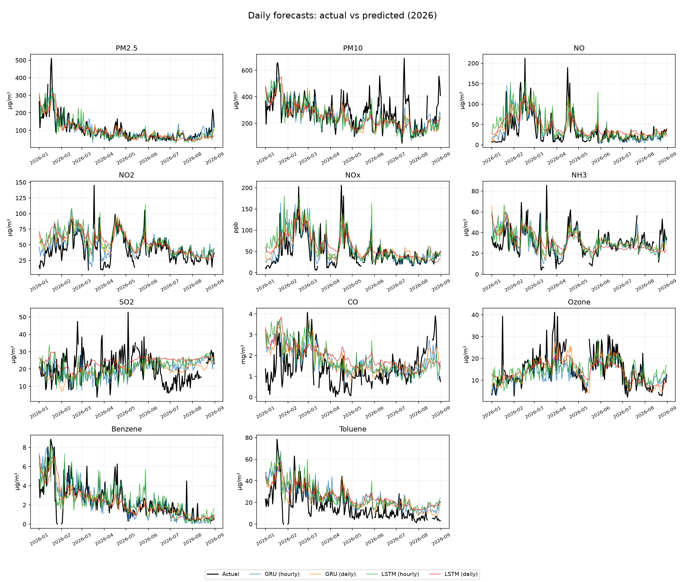
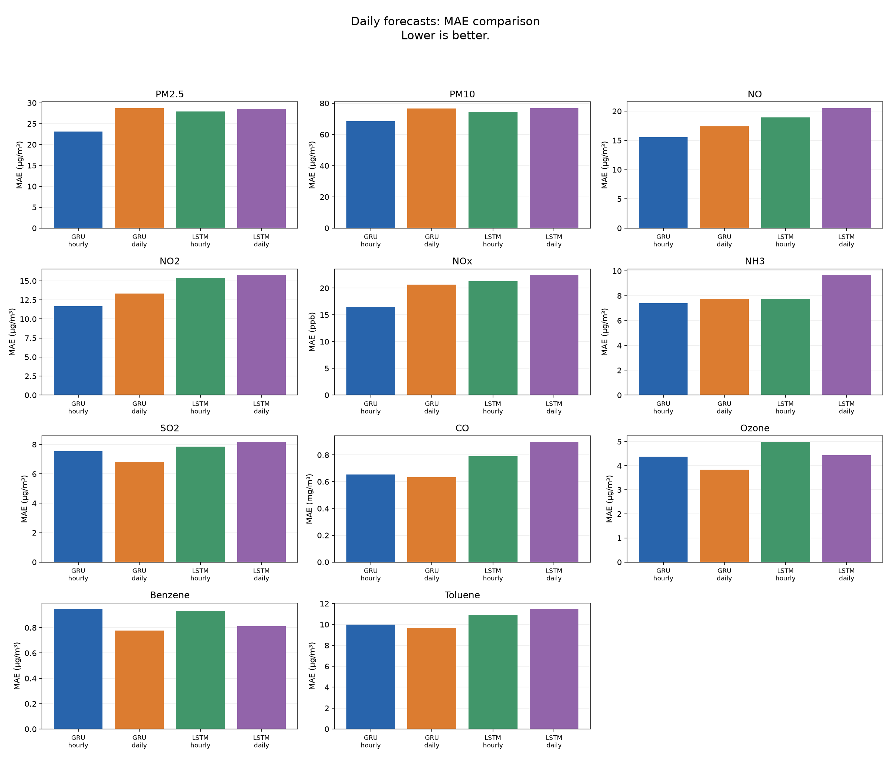
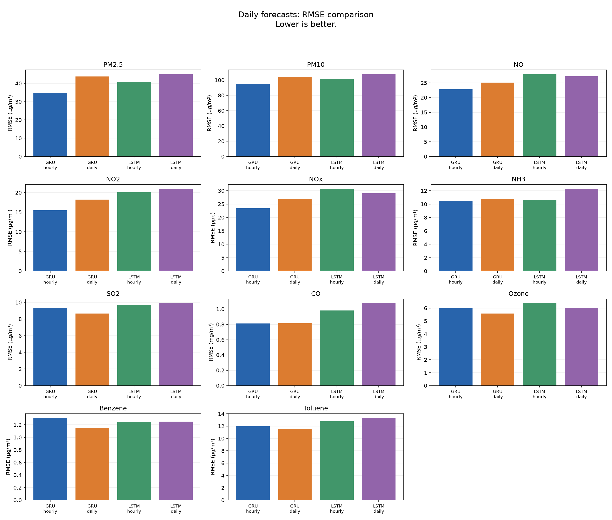
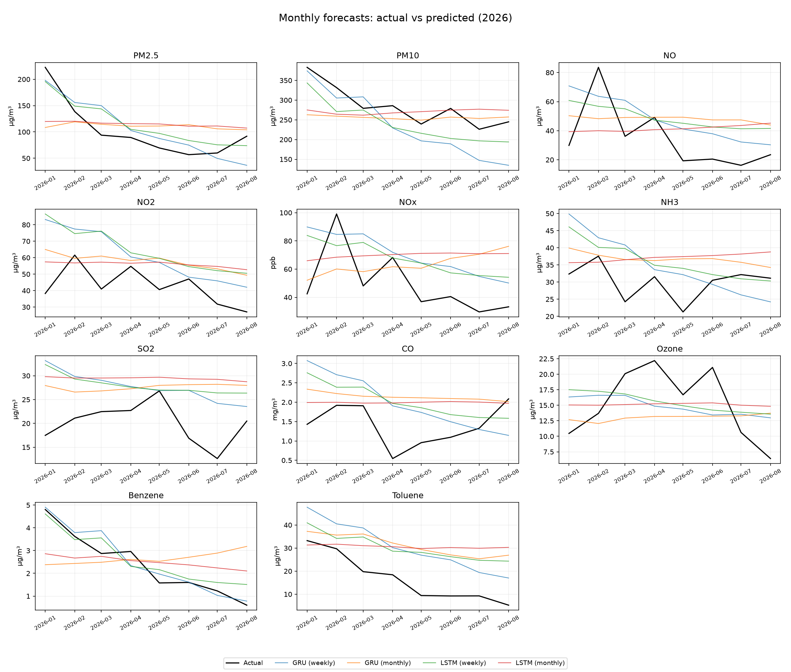
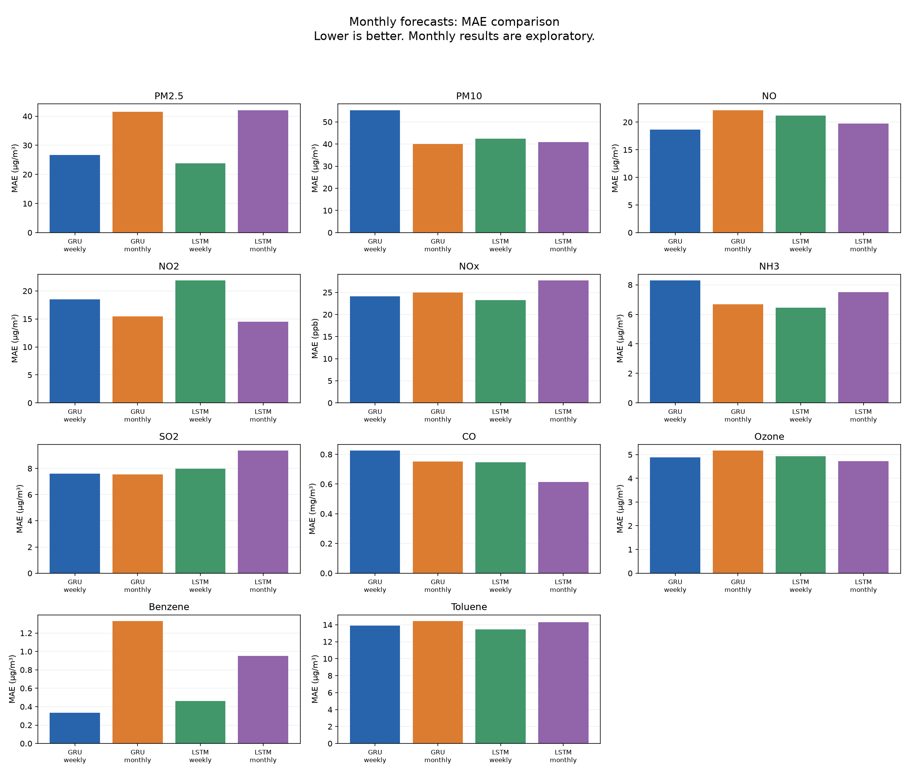
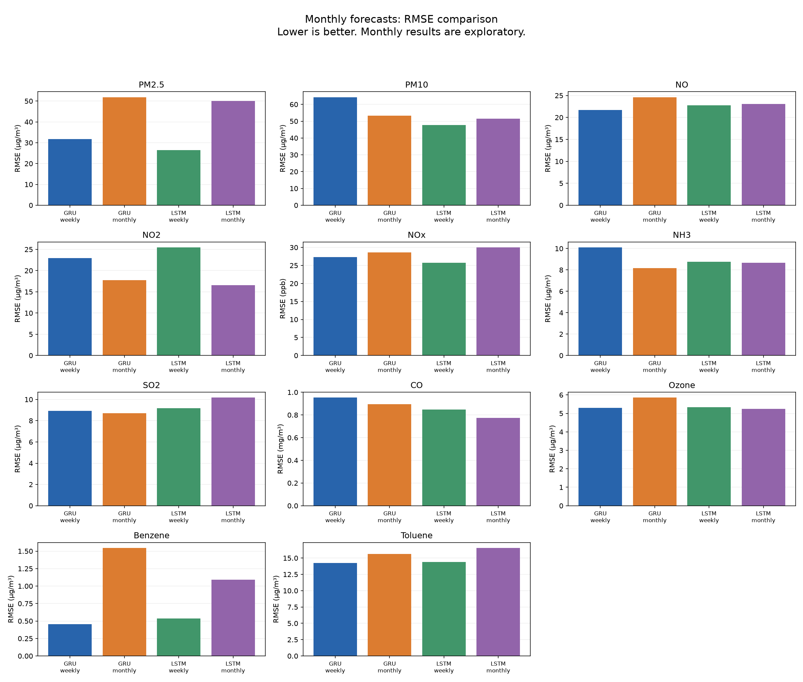
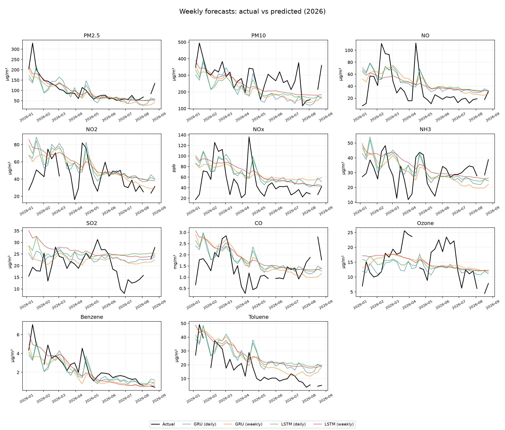
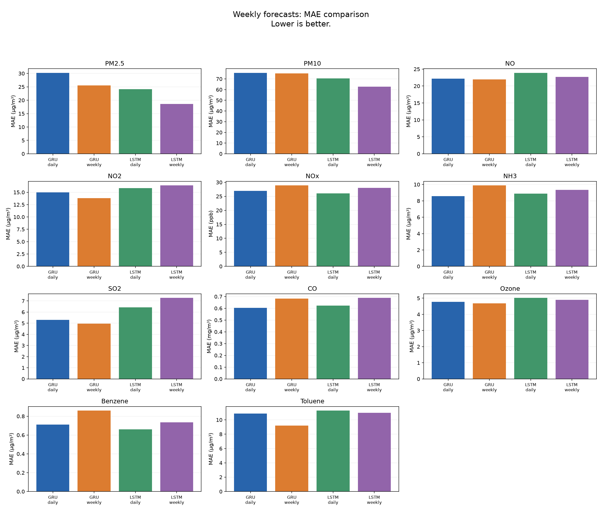
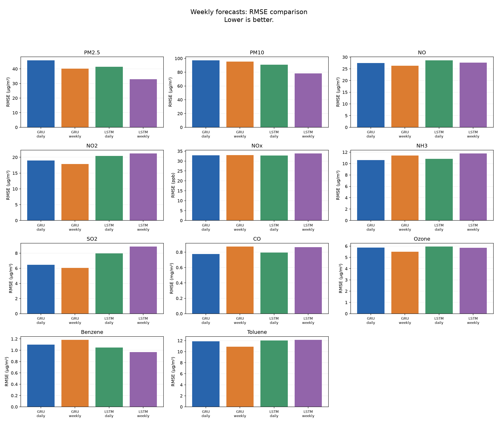

# Results

Train: 2025. Test: January-August 2026. Lower errors are better.

| Target | Pollutant | Lowest RMSE in this run | Input | MAE | RMSE |
|---|---|---|---|---:|---:|
| daily | PM2.5 | GRU | hourly | 23.14 | 34.88 |
| daily | PM10 | GRU | hourly | 68.51 | 94.57 |
| daily | NO | GRU | hourly | 15.57 | 22.80 |
| daily | NO2 | GRU | hourly | 11.70 | 15.45 |
| daily | NOx | GRU | hourly | 16.47 | 23.40 |
| daily | NH3 | GRU | hourly | 7.40 | 10.40 |
| daily | SO2 | GRU | daily | 6.81 | 8.65 |
| daily | CO | GRU | hourly | 0.65 | 0.81 |
| daily | Ozone | GRU | daily | 3.84 | 5.57 |
| daily | Benzene | GRU | daily | 0.78 | 1.15 |
| daily | Toluene | GRU | daily | 9.67 | 11.59 |
| weekly | PM2.5 | LSTM | weekly | 18.63 | 33.00 |
| weekly | PM10 | LSTM | weekly | 62.80 | 78.35 |
| weekly | NO | GRU | weekly | 21.98 | 26.35 |
| weekly | NO2 | GRU | weekly | 13.84 | 17.89 |
| weekly | NOx | LSTM | daily | 26.08 | 32.84 |
| weekly | NH3 | GRU | daily | 8.59 | 10.62 |
| weekly | SO2 | GRU | weekly | 4.96 | 6.04 |
| weekly | CO | GRU | daily | 0.60 | 0.78 |
| weekly | Ozone | GRU | weekly | 4.68 | 5.49 |
| weekly | Benzene | LSTM | weekly | 0.74 | 0.97 |
| weekly | Toluene | GRU | weekly | 9.22 | 10.91 |
| monthly | PM2.5 | LSTM | weekly | 23.84 | 26.50 |
| monthly | PM10 | LSTM | weekly | 42.49 | 47.63 |
| monthly | NO | GRU | weekly | 18.67 | 21.71 |
| monthly | NO2 | LSTM | monthly | 14.49 | 16.56 |
| monthly | NOx | LSTM | weekly | 23.24 | 25.75 |
| monthly | NH3 | GRU | monthly | 6.68 | 8.17 |
| monthly | SO2 | GRU | monthly | 7.54 | 8.70 |
| monthly | CO | LSTM | monthly | 0.61 | 0.77 |
| monthly | Ozone | LSTM | monthly | 4.72 | 5.25 |
| monthly | Benzene | GRU | weekly | 0.33 | 0.46 |
| monthly | Toluene | GRU | weekly | 13.89 | 14.22 |

These are results from one seeded run. Monthly results are exploratory. Errors use original units; do not average errors across pollutants.

## Graphs

### Daily actual vs predicted

### Daily mae

### Daily rmse

### Monthly actual vs predicted

### Monthly mae

### Monthly rmse

### Weekly actual vs predicted

### Weekly mae

### Weekly rmse

