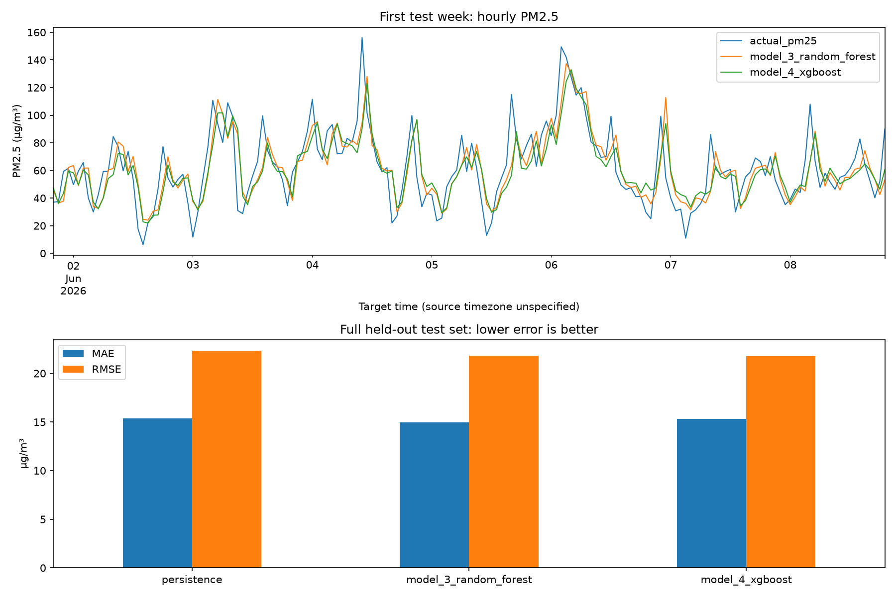

# Delhi Anand Vihar air quality: tree-based regression

**Model 3: Random Forest Regressor** and **Model 4: XGBoost Regressor**, trained to predict **PM2.5 (µg/m³) one hour ahead** from hourly pollutant observations.

The dataset and prediction objective were supplied/confirmed by the project owner. The raw CSV is kept out of Git following the shared repository's convention; see [dataset setup](data/README.md). No external data or AQI conversion is used. This is a research prototype, not a validated health advisory system.

**Evaluation scope:** this submission preserves the previously trained one-hour-ahead PM2.5 models and their chronological 70/15/15 split. It does not implement the shared project's daily/weekly/monthly, all-pollutant, 2025-training/2026-testing protocol. Its scores must not be compared directly with team models using that protocol. The models were transferred as ordinary files without retraining or a nested repository.

## Results

See [the evaluation report](reports/RESULTS.md), [test metrics](reports/test_metrics.csv), and [all test predictions](reports/test_predictions.csv).



## Reproduce training

Python 3.12 was used. Dependencies are pinned to the training environment.

Run these commands from the `rishi/` folder after placing the source CSV in `rishi/data/`.

```bash
python3 -m venv .venv
source .venv/bin/activate
python -m pip install -r requirements.txt
python -m unittest discover -s tests -v
python train.py
```

Training regenerates the fitted models and reports. The random seed is 42 and each learner uses four CPU workers. Small numerical differences may occur across systems. On macOS, if XGBoost reports a missing OpenMP library, install it with `brew install libomp`.

## Make a forecast

```bash
python predict.py \
  --data data/Delhi_AnandVihar_2025_Aug2026_11pollutants_combined_unimputed.csv \
  --model models/model_4_xgboost.joblib
```

Supply a CSV with the same timestamp and 11 pollutant columns, including recent history (ideally at least 169 hourly rows). The output predicts the hour following the latest row. Predictions after August 2026 cannot be evaluated using this file. A `joblib` file contains the fitted imputer and estimator; only load trusted model files. XGBoost is additionally exported as JSON; that file alone does not include preprocessing.

## Method

- **Data:** 14,592 consecutive hours, January 1, 2025–August 31, 2026, at Delhi Anand Vihar. Timestamps have no timezone in the source; no timezone is invented. Source provenance, measurement validity, and redistribution rights are not independently established.
- **Target:** observed PM2.5 at hour `t+1`. Missing target values are excluded, never imputed. An explicit hourly index ensures that a shift means one hour.
- **Features:** all 11 pollutant readings at issue time `t`, PM2.5 lags of 1, 2, 3, 24, and 168 hours, trailing means and standard deviations over 3, 24, and 168 hours, and cyclic calendar features for the forecast hour. Trailing windows include the current hour. No future pollutant readings enter the features.
- **Split:** first 70% of the hourly timeline for training, next 15% for validation, final 15% for testing, before dropping missing labels. At each boundary, the preceding partition's final forecast is purged so its target does not fall in the next partition.
- **Missing predictors:** median imputation plus missingness indicators, fitted inside each training pipeline. During tuning, medians use training rows only; the final fit uses training and validation rows. No bidirectional interpolation or future imputation is used. Observed outliers are retained.
- **Selection:** three parameter candidates per learner, ranked by validation RMSE. Selected settings are refitted on training plus validation, then scored once on the held-out test partition. The refit excludes the two purged boundary rows. This is a small chronological validation search, not extensive cross-validation.
- **Baseline:** the most recently observed PM2.5, carried forward causally. If no earlier reading exists, the training/development median is used as a fallback. All methods are evaluated on the same test targets.
- **Evaluation:** MAE, RMSE, and R² on concentration values. MAE and RMSE are in µg/m³; lower is better. R² is dimensionless and can be negative.
- **Simulation:** rolling one-hour-ahead forecasting: each test hour may use actual readings already observed by that hour, including prior test hours. This is not a fixed-origin forecast of the entire test period.

The holdout covers one seasonal period at one station. Results cannot establish year-round performance, transfer to other locations, or performance under delayed sensor reporting. Current-hour readings must actually be available when issuing a forecast. Feature importance is predictive, not causal, and correlated pollutants can share importance.

## Files

| Path | Purpose |
| --- | --- |
| `train.py` | Reproducible training, validation, final evaluation, exports |
| `src/features.py` | Shared causal feature engineering and temporal splits |
| `predict.py` | Forecast from a history CSV using a saved pipeline |
| `models/` | Both fitted pipelines and native XGBoost export |
| `reports/` | Metrics, selected parameters, data checksum, predictions, importance plots |
| `tests/` | Future-data invariance, split-boundary and missing-label checks |

Library references: [Random Forest](https://scikit-learn.org/stable/modules/generated/sklearn.ensemble.RandomForestRegressor.html), [median imputation](https://scikit-learn.org/stable/modules/generated/sklearn.impute.SimpleImputer.html), [XGBoost model export](https://xgboost.readthedocs.io/en/stable/tutorials/saving_model.html).
